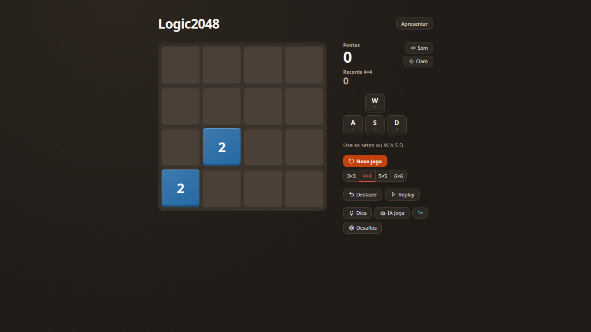
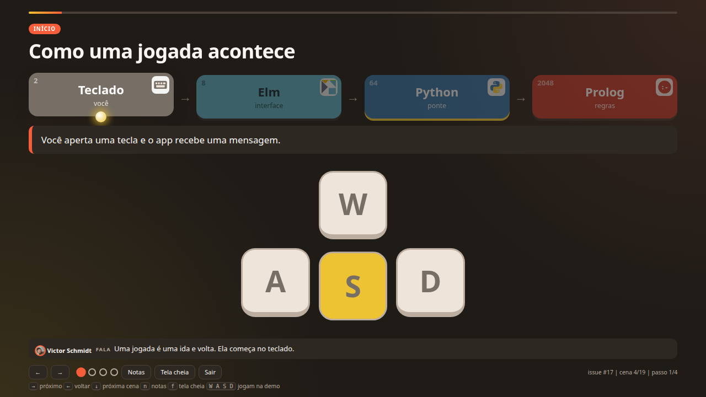

# Logic2048

## 1. Identificação

| Nome completo | Matrícula | Turma (14h/16h) | Usuário GitHub |
|---------------|-----------|-----------------|----------------|
| Victor Hugo Lima Schmidt | 222021924 | 16h | @moonshinerd |
| Bianca Patrocínio Castro | 221008801 | 16h | @BiancaPatrocinio7 |
| Davi de Aguiar Vieira | 222006641 | 16h | @davi-aguiar-vieira |
| Kaio Macedo Santana | 222006893 | 16h | @bigkaio |
| Mateus de Castro Santos | 222015195 | 16h | @mat054 |
| Mateus Henrique Queiroz Magalhães Sousa | 222025950 | 16h | @Mateushqms |
| William Bernardo da Silva | 222021933 | 16h | @WillxBernardo |

- **Nome do projeto:** Logic2048
- **Nome do grupo:** Backtrackers
- **Repositório:** https://github.com/disciplines-moon/logic-2048
- **Commit ou tag entregue:** `v1.0`
- **Ponto de partida:** outro jogo conhecido
- **Slides da apresentação oral:** não há

O projeto não partiu do template do Sudoku: o esqueleto (Elm, Python e Prolog)
foi escrito para este projeto, com Claude Code, no mesmo desenho de três camadas
do template (seção 11). Não há slides porque a apresentação é uma página do próprio app, em
`#/apresentacao`, com o jogo funcionando dentro das cenas (seção 12).

## 2. Resumo

Logic2048 é o jogo 2048 (deslizar peças num tabuleiro e fundir as iguais até
chegar a 2048) em tabuleiros de 3×3 a 6×6. Todas as regras moram no Prolog:
mover, fundir, pontuar, vitória e derrota, e também dois modos que são busca de
verdade: a **dica** (o Prolog escolhe a melhor jogada com expectimax, levando em
conta que a peça nova nasce ao acaso) e os **desafios** (o Prolog acha a menor
sequência de jogadas que chega a uma peça alvo, com CLP(FD) e backtracking). O
Elm guarda o estado, sorteia as peças, desenha e anima a tela, tem desfazer,
replay, uma IA que joga sozinha pedindo a dica ao Prolog, e a apresentação do
trabalho. O Python só valida a entrada e traduz JSON para Prolog e de volta.





## 3. Como executar

**Requisitos** (com as versões que o grupo usou):

- SWI-Prolog 9.2.9 (mínimo 9.1.12, por causa da ponte `janus`), com os cabeçalhos de desenvolvimento (`libswipl-dev` ou `swi-prolog-nox`) e `gcc`, para compilar o `janus-swi`
- Node.js 22 (mínimo 20) e npm
- uv 0.11 (mínimo 0.5) e Python 3.12 (mínimo 3.11)
- Navegador moderno de desktop

**Instalação e execução:**

```sh
git clone https://github.com/disciplines-moon/logic-2048.git
cd logic-2048
git checkout v1.0

# Opção 1: um comando só. Compila a interface e o FastAPI serve API e interface
# juntas em http://localhost:8000 (a apresentação fica em /#/apresentacao).
make install
make rodar            # o mesmo que: sh scripts/rodar.sh

# Opção 2: desenvolvimento, em dois terminais
cd server && uv sync && uv run fastapi dev main.py --port 8000   # API
cd web && npm install && npm run dev                              # http://localhost:5173
```

Na primeira vez, o `uv sync` compila o `janus-swi`. Com gcc 14 ou mais novo a
compilação pode falhar por um aviso tratado como erro; a solução está no README,
seção "Instalando o janus-swi":

```sh
cd server
CFLAGS="-Wno-error=incompatible-pointer-types -Wno-incompatible-pointer-types" uv sync
```

**Testes:**

```sh
make test             # tudo: Prolog, Python e Elm
make test-prolog      # plunit: prolog/test_game.pl, test_hint.pl e test_challenge.pl
make test-backend     # pytest da API, chamando o Prolog de verdade
make test-web         # elm-format, verificação de armadilhas, elm-test e build
make validar          # forma deste relatório
```

**Testado em:** Linux (Ubuntu 26.04) com Google Chrome, em telas de 1280×720, 1853×871 e 1920×1080. A CI do GitHub (`.github/workflows/ci.yml`) roda os testes de Prolog e Python dentro da imagem oficial `swipl:10.0.2` e os do Elm no Ubuntu, em todo PR. No Windows, use o WSL.

## 4. Arquitetura

```
Teclado ──▶ Elm (estado, sorteio, tela) ──HTTP/JSON──▶ Python (ponte) ──janus──▶ Prolog (regras)
                  ▲                                                                   │
                  └──────────── resposta: tabuleiro, pontos, moved, won, lost ◀───────┘
```

Uma jogada é uma ida e volta: o Elm manda o tabuleiro e a direção para
`POST /api/move`; o Python valida e chama `game:move_trace/5`; o Prolog devolve o
tabuleiro novo, os pontos e o caminho de cada peça; o Elm sorteia a peça nova
(o Prolog é puro e não sorteia nada), atualiza o `Model` e anima a tela. A
regra de ouro do projeto: **uma regra de jogo existe em um só lugar, o Prolog**.
O Elm nunca recalcula um movimento. O desenho completo, com os donos de cada
arquivo, está em `docs/arquitetura.md`, e o formato de todos os dados em
`docs/contrato.md`.

| Parte  | Responsabilidade | Arquivos principais |
|--------|------------------|---------------------|
| Prolog | Regras: mover e fundir nas 4 direções, pontos, vitória por N, derrota, caminho das peças; dica (expectimax); desafios (CLP(FD) e busca). Puro: o mesmo tabuleiro sempre dá a mesma resposta | `prolog/game.pl`, `prolog/hint.pl`, `prolog/challenge.pl` |
| Elm    | Estado do jogo, sorteio de peças (`Random`), teclado e swipe, histórico (desfazer e replay), dica, IA e desafios na tela, animações, efeitos por ports (sons, confete, recorde) e a apresentação | `web/src/Game.elm`, `web/src/Game/*.elm`, `web/src/Api.elm`, `web/src/Main.elm`, `web/src/Presentation.elm`, `web/src/Cenas/*.elm` |
| Python | Só integração: valida a entrada (422 com mensagem em português), chama o Prolog pelo `janus` e traduz a resposta para JSON | `server/main.py`, `server/extras.py` |

Em linhas de código, sem contar testes nem dependências: Prolog 1.591 (com
testes), Elm 8.093 (das quais cerca de 3.200 são a apresentação: o motor e as cenas) e
Python 905 (com testes), ou seja, o Python fica perto de 8,5% do total.

## 5. Parte em Prolog

### 5.1 Predicados principais

| Predicado | Local | O que faz |
|-----------|-------|-----------|
| `slide_left(+Row, -NewRow, -Points)` | `prolog/game.pl:8` | Desliza uma linha para a esquerda e funde os pares iguais vizinhos (cada peça funde uma vez por jogada), devolvendo os pontos |
| `merge(+Tiles, -Merged, -Points)` | `prolog/game.pl:15` | O coração da fusão, por recursão: `[X,X|T]` vira `2X`, senão a peça passa adiante |
| `move(+Board, ?Dir, -NewBoard, -Score)` | `prolog/game.pl:37` | Uma jogada em qualquer direção de um tabuleiro N×N. Com `Dir` livre, enumera as 4 direções por backtracking |
| `move_dir/4` e `transpose_board/2` | `prolog/game.pl:44`, `prolog/game.pl:74` | Uma regra só (`slide_left`) e três transformações: direita é espelho, cima é transposta, baixo é transposta mais espelho |
| `game_won(+Board)` | `prolog/game.pl:92` | Vitória com a peça do tamanho: 256 no 3×3, 2048 no 4×4, 4096 no 5×5 e 8192 no 6×6 (fatos `win_tile/2`) |
| `available_moves(+Board, -Dirs)` | `prolog/game.pl:119` | As direções que mudam o tabuleiro, com `findall` sobre `can_move/2` |
| `game_lost(+Board)` | `prolog/game.pl:128` | Derrota como negação: `\+ can_move(Board, _)`, nenhuma direção muda nada |
| `move_trace(+Board, +Dir, -NewBoard, -Score, -Moves)` | `prolog/game.pl:140` | O `move/4` mais o caminho de cada peça (origem, destino e se fundiu), para o Elm animar sem calcular nada |
| `hint(+Board, +Depth, -Best, -Scores)` | `prolog/hint.pl:38` | A dica: o valor esperado de cada direção e a melhor delas (`none` se não há jogada) |
| `max_value/3` e `chance_value/3` | `prolog/hint.pl:64`, `prolog/hint.pl:97` | Os dois tipos de nó do expectimax: o máximo (nossa jogada) e a média ponderada (a peça que o acaso põe). Tabuleiro perdido (`game_lost/1`) vale −1.000.000, então a dica nunca prefere uma jogada com risco de derrota |
| `evaluate(+Board, -Score)` | `prolog/hint.pl:143` | A heurística nas folhas: casas vazias, desordem das linhas e colunas, e bônus pela maior peça no canto |
| `challenge(+Board, +Target, +MaxMoves, -Moves)` | `prolog/challenge.pl:24` | A menor sequência de jogadas, sem peças novas, que chega a uma peça maior ou igual ao alvo. Sem solução, falha |

### 5.2 Conceitos do paradigma lógico utilizados

- [x] Fatos e regras como base de conhecimento: a peça de vitória de cada tamanho são fatos (`win_tile/2`, `prolog/game.pl:102`), assim como as probabilidades do sorteio (`spawn/2`, `prolog/hint.pl:113`) e a codificação das direções (`code_dir/2`, `prolog/challenge.pl:76`).
- [x] Unificação e casamento de padrões: a fusão é casamento de padrão na cabeça da cláusula, `merge([X,X|T], [Y|R], Points)` (`prolog/game.pl:16`); cada direção é uma cláusula de `move_dir/4` escolhida por unificação com o átomo da direção (`prolog/game.pl:44`).
- [x] Recursão (inclusive sobre listas): `merge/3` (`prolog/game.pl:15`), a transposta de qualquer N (`transpose_board_/3`, `prolog/game.pl:79`), a árvore do expectimax como recursão mútua entre `max_value/3` e `chance_value/3`, e o `play/3` dos desafios (`prolog/challenge.pl:59`).
- [x] Backtracking e múltiplas soluções: `move/4` com a direção livre enumera as 4 jogadas (`?- move(B, D, N, S).` dá uma resposta por direção); `can_move/2` é não determinístico; os desafios são busca por backtracking sobre as direções, e a expectimax percorre todas as casas vazias e as duas peças possíveis por `member/2`.
- [x] `findall/3`, `bagof/3`, `setof/3` ou similares: `available_moves/2` (`prolog/game.pl:119`) e `hint/4` usam `findall/3`; a expectimax usa `aggregate_all(max(V), ...)` no nó de máximo e `aggregate_all(sum(P * V), ...)` no nó de sorteio (`prolog/hint.pl:97`).
- [x] Corte (`!`) ou negação (`\+`), e por que foram necessários: a derrota é `\+ can_move(Board, _)` (`prolog/game.pl:128`), ou seja, falhar em provar que existe jogada; o corte em `merge/3` impede que, depois de fundir um par, o backtracking tente a alternativa de não fundir (o que daria resultados errados); em `has_tile/2` o corte para na primeira peça que basta. `once/1` escolhe a primeira resposta onde só uma interessa (o desempate da dica e a menor sequência do desafio).
- [x] Programação por restrições (CLP(FD) ou outra): nos desafios (`prolog/challenge.pl:34`). A soma das peças é invariante sem peças novas (`sum(Cells, #=, Sum), Target #=< Sum`), cada jogada no máximo dobra a maior peça (`Max * 2^Len #>= Target`), e o `labeling` sobre o tamanho da sequência faz aprofundamento iterativo, de modo que a primeira resposta é a menor.
- [x] Predicados de ordem superior (`maplist`, `foldl`, `include` e afins): `maplist` aplica `slide_left/3` a todas as linhas (`slide_rows/3`, `prolog/game.pl:61`), monta colunas na transposta e converte códigos em direções; na dica, `aggregate_all/3` faz o máximo e a média, e `foldl/4` soma a desordem de todas as linhas e colunas (`prolog/hint.pl:163`).
- [x] Outro: testes plunit (164 testes em `prolog/test_game.pl`, `test_hint.pl` e `test_challenge.pl`), incluindo testes das soluções dos desafios do jogo e dos valores mostrados na apresentação, e documentação com o modo de cada argumento (`+`, `-`, `?`) e o determinismo (`is det`, `is semidet`, `is nondet`).

### 5.3 Trecho em destaque

Os desafios (`prolog/challenge.pl`, a partir da linha 34): dado um tabuleiro, achar a menor
sequência de no máximo `MaxMoves` jogadas, **sem peças novas**, que crie uma peça
maior ou igual a `Target`.

```prolog
solve(Board, Target, MaxMoves, Moves) :-
    append(Board, Cells),             % todas as casas numa lista só
    % ---- RESTRIÇÕES ---------------------------------------------------------
    sum(Cells, #=, Sum),
    Target #=< Sum,                   % sem peças novas, a soma é invariante
    max_list(Cells, Max),
    Len in 1..MaxMoves,
    Max * 2^Len #>= Target,           % cada jogada no máximo dobra a maior peça
    % ---- BUSCA --------------------------------------------------------------
    once(( labeling([up], [Len]),     % tenta 1 jogada, depois 2, depois 3...
           length(Codes, Len),
           Codes ins 1..4,            % cada jogada é uma direção (1 a 4)
           play(Codes, Board, Target) )),
    maplist(code_dir, Codes, Moves).

play([], Board, Target) :-
    has_tile(Board, Target).          % acabaram as jogadas: chegou ao alvo?
play([Code|Codes], Board, Target) :-
    length(Codes, Rest),
    append(Board, Cells),
    max_list(Cells, Max),
    Max * 2^(Rest + 1) #>= Target,    % ainda dá para chegar? se não, poda
    labeling([], [Code]),             % escolhe a direção por backtracking
    code_dir(Code, Dir),
    move(Board, Dir, Next, _),
    Next \== Board,                   % jogada sem efeito não conta
    play(Codes, Next, Target).
```

**Como funciona.** O predicado não descreve um algoritmo de busca passo a passo;
ele declara o que uma resposta precisa cumprir e deixa o Prolog procurar.

1. **Restrições antes de jogar.** Sem peças novas, deslizar e fundir não cria nem
   destrói valor (2 + 2 vira 4), então a soma das peças é invariante. Se o alvo é
   maior que a soma, `Target #=< Sum` falha na hora, sem simular nenhuma jogada.
   E como uma peça só funde uma vez por jogada, a maior peça no máximo dobra a cada
   jogada: `Max * 2^Len #>= Target` corta, antes de qualquer busca, os tamanhos de
   sequência curtos demais.
2. **A menor sequência sai de graça.** `labeling([up], [Len])` tenta os valores de
   `Len` em ordem crescente. Para cada tamanho, `play/3` procura uma sequência
   daquele tamanho; a primeira que o Prolog encontrar é, portanto, a menor. É um
   aprofundamento iterativo que ninguém programou como laço: ele sai da ordem do
   labeling e do backtracking.
3. **Backtracking com poda.** Em `play/3`, `labeling([], [Code])` escolhe uma
   direção; se o resto da sequência não chega ao alvo, o Prolog volta e tenta a
   próxima direção. A cada passo a restrição `Max * 2^(Rest + 1) #>= Target` é
   conferida de novo e poda ramos que não têm como chegar lá. Jogadas que não
   mudam o tabuleiro são descartadas (`Next \== Board`), o que só poda: a menor
   sequência nunca teria uma.
4. **A regra é reaproveitada, não reescrita.** O efeito de cada jogada é o mesmo
   `move/4` do jogo. Por isso o desafio não pode divergir do jogo.

**Por que é lógico e não uma tradução imperativa.** Não existe fila, pilha,
contador de profundidade nem laço de "tente a próxima direção": a enumeração das
direções é o backtracking, a ordem crescente de tamanhos é o labeling e a poda é
uma restrição aritmética declarada uma vez. "Sem solução" também é natural: o
predicado simplesmente falha, e o Python traduz a falha para `"solvable": false`.
Os três desafios do jogo (`server/data/challenges.json`) são conferidos em
`prolog/test_challenge.pl` e de novo pela API em `server/test_extras.py`.

A dica (`prolog/hint.pl`) é o outro trecho de que o grupo mais gosta: a árvore do
expectimax inteira é a recursão mútua entre `max_value/3` (o melhor dos filhos,
com `aggregate_all(max(V), ...)`) e `chance_value/3` (a média ponderada sobre
todas as casas vazias e as peças 2 e 4, com `aggregate_all(sum(P * V), ...)`), sem
nenhum laço: os filhos são enumerados por backtracking.

## 6. Parte em Elm

### 6.1 Modelo e mensagens

```elm
-- web/src/Game.elm
type Status
    = Playing
    | Won
    | Lost

type alias Model =
    { board : Board
    , size : Int
    , score : Int
    , status : Status
    , waiting : Bool                       -- resposta do Prolog ou sorteio em voo
    , error : Maybe String
    , touchStart : Maybe Point
    , history : History Snapshot           -- desfazer e replay (#7)
    , replay : Maybe (Replay Snapshot)     -- só existe com o replay aberto
    , theme : Theme
    , pieces : List Piece                  -- peças com identidade, para animar
    , nextId : Int
    , slowMotion : Bool
    , best : Dict Int Int                  -- recorde por tamanho
    , muted : Bool
    , celebrated : Bool
    , showWin : Bool
    , ranked : Bool
    , assist : Assist                      -- dica, IA e desafios (#20)
    }

type Msg
    = Pressed Direction
    | GotMove Board (Result Http.Error Api.MoveResponse)
    | Spawned Board (List Tile)
    | NewGame
    | SizeChosen Int
    | Undo
    | ReplayStarted
    | ReplayTicked
    | LoadBoard Board
    | AssistMsg Assist.Msg
      -- e outras: toque, pausa e velocidade do replay, tema, som e vitória

-- web/src/Game/Assist.elm
type Ai
    = Off
    | Thinking      -- o pedido de dica está em voo
    | Playing       -- a jogada foi mandada, ou a IA espera o intervalo

type Action
    = None
    | Play Direction           -- jogar como uma tecla (com sorteio de peça)
    | Step Api.MoveResponse    -- passo do desafio, SEM sortear peça
    | Show Board
    | Restart
    | Settle                   -- sem jogada: o Prolog declara o fim de jogo

-- web/src/Api.elm
type Error
    = Network                  -- sem resposta (inclui 502 a 504 do proxy)
    | Rejected String          -- 422, com a mensagem do servidor
    | Server Int
    | Invalid                  -- resposta fora do formato
```

Locais: `Status` em `web/src/Game.elm:82`, `Model` em `web/src/Game.elm:113`, `Msg` em `web/src/Game.elm:190`, `Ai` em `web/src/Game/Assist.elm:66`, `Action` em `web/src/Game/Assist.elm:134` e `Error` em `web/src/Api.elm:297`.

**As escolhas.**

- **`Status` é um custom type, e não dois `Bool` (`won` e `lost`).** Com dois
  booleanos existiria o estado "venceu e perdeu ao mesmo tempo", que não faz
  sentido. Com o tipo, ele não pode ser escrito.
- **`replay : Maybe (Replay Snapshot)`.** O replay só existe enquanto está aberto;
  não há um `Replay` "vazio" ou "desligado" para conferir. O mesmo vale para o
  desafio aberto (`active : Maybe Active` no `Assist`).
- **A IA é uma máquina de estados (`Off | Thinking | Playing`), e não um
  `Bool`.** Com um `aiOn : Bool` não daria para saber se já existe uma dica em
  voo, e a IA poderia disparar duas requisições ao mesmo tempo. Com o tipo, o
  relógio só existe em `Playing`, então no máximo uma requisição fica em voo
  (seção 6.3).
- **O `Assist` não executa nada, devolve uma `Action`.** O módulo de dica, IA e
  desafios é puro: recebe um retrato do jogo (`Context`) e devolve o estado novo,
  os pedidos HTTP e o que o `Game` deve fazer. `Play` e `Step` são casos
  diferentes justamente porque o desafio não pode sortear peça, e o compilador
  obriga o `Game` a tratar os dois.
- **`GotMove` e `Spawned` carregam o tabuleiro em que foram pedidos.** Uma
  resposta que chega depois de um Novo jogo, de uma troca de tamanho ou de um
  desfazer é comparada com o tabuleiro atual e descartada. Isso evita o
  problema clássico de resposta atrasada.
- **`Api.Error` no lugar de `Http.Error`.** O `Http.Error` do Elm não guarda o
  corpo de um 422, onde o servidor manda a mensagem em português. O nosso tipo
  tem um caso para cada situação que importa a quem joga, e `errorMessage`
  (`web/src/Api.elm:338`) transforma cada caso numa frase.
- **O histórico é uma lista de `Snapshot`s (`Game/History.elm`), já com a peça
  sorteada.** Desfazer é tirar o topo; o replay só mostra a lista de novo, sem
  sortear nem perguntar ao Prolog, por isso a partida sai igual.

### 6.2 Conceitos do paradigma funcional utilizados

- [x] Arquitetura Elm (Model, update, view): `web/src/Main.elm` é a casca (rotas `#/` e `#/apresentacao`); o jogo é `Game.elm` (`update` em `web/src/Game.elm:291`) e `Game/View.elm`; a apresentação é outro programa TEA em `Presentation.elm`, que reaproveita a mesma `view` do jogo na `Demo`.
- [x] Custom types e `case` exaustivo: `Status`, `Theme`, `PieceKind`, `Ai`, `Panel`, `Action`, `Api.Error`, `Effect`, `Sound` e o `Block` das cenas (`web/src/Cenas/Types.elm`). Todo `case` sobre eles é exaustivo, e acrescentar um caso faz o compilador apontar cada lugar a mudar.
- [x] `Maybe` e `Result` no lugar de null e exceções: `replay`, `error`, `touchStart`, a dica guardada com o tabuleiro dela (`Maybe ( Board, Api.Hint )`), `Result Api.Error a` em todas as respostas da API, e `History.undo` devolve `Maybe` (histórico vazio não tem o que desfazer).
- [x] Funções de ordem superior e aplicação parcial: `List.indexedMap`, `List.foldl` e `List.filterMap` na montagem do tabuleiro e das peças; `Cmd.map AssistMsg` e `Sub.map GameMsg` ligam os módulos; mensagens parcialmente aplicadas como `GotMove model.board` e `GotHint ctx.board` levam o tabuleiro junto.
- [x] Composição (`|>`, `>>`): por todo o código, por exemplo `Maybe.andThen History.current model.replay` e cadeias `|>` no `update` e nos testes.
- [x] Decoders e encoders JSON: `web/src/Api.elm` (`moveDecoder` em `web/src/Api.elm:133`, `hintDecoder` em `web/src/Api.elm:387`, desafios e soluções); as preferências salvas no navegador entram pelas flags com decoder próprio (`Game/Effects.elm`).
- [x] Comandos e subscriptions (efeitos controlados): o sorteio de peças é um `Random.Generator` (`newTile`, `web/src/Game.elm:830`) executado pelo runtime, que devolve `Spawned`; o relógio da IA e do replay são `Time.every` que só existem quando necessários (`Game.subscriptions`, `web/src/Game.elm:1030`); sons, confete e recorde são dados (`Game/Effects.elm`, `web/src/Game/Effects.elm:16`) que viram `Cmd` só em `perform`, saindo por ports (`web/src/Ports.elm`) para o JavaScript.
- [x] Imutabilidade e atualização de records: o `update` sempre devolve um `Model` novo (`{ model | board = ..., waiting = False }`); o histórico é uma lista imutável em que desfazer é só pegar a cauda.
- [x] Outro: 153 testes com `elm-test` (`web/tests/`), incluindo fuzz tests do sorteio, os casos de resposta atrasada e a máquina de estados da IA; `elm-format` aplicado e conferido pela CI.

### 6.3 Trecho em destaque

A IA que joga sozinha (`web/src/Game/Assist.elm`, `ticks` em `web/src/Game/Assist.elm:214` e a mensagem `AiTicked` em `web/src/Game/Assist.elm:276`):

```elm
ticks : Context -> Assist -> Sub Msg
ticks ctx assist =
    if assist.ai == Playing && not ctx.waiting then
        Time.every assist.interval (\_ -> AiTicked)

    else if hintStale ctx assist then
        -- Dicas ligadas e o tabuleiro mudou: pede a dica nova assim que o jogo parar.
        Time.every 50 (\_ -> HintRefresh)

    else
        Sub.none

-- dentro de update:
        AiTicked ->
            if assist.ai /= Playing || ctx.waiting then
                ( assist, Cmd.none, None )

            else if ctx.lost || (ctx.won && not assist.wonBefore) || ctx.failed then
                -- Fim de jogo, vitória nesta corrida ou erro: a IA para sozinha e diz por quê.
                ( { assist | ai = Off, note = Just (stopReason ctx) }, Cmd.none, None )

            else
                ( { assist | ai = Thinking }, Api.postHint ctx.board (GotHint ctx.board), None )
```

**Como funciona.** A IA é um laço "pede a dica ao Prolog, joga, espera, repete",
mas não existe laço nenhum no código. Ela é uma máquina de estados:

```
Off ──ligar──▶ Playing ──(intervalo)──▶ Thinking ──dica chega──▶ Playing ──…
                 │  joga a direção          pede /api/hint            │
                 └──── espera a jogada voltar (Game.waiting) ◀────────┘
```

- **O relógio é uma função do estado.** `ticks` é chamada pelo runtime a cada
  mudança do `Model`. Ela só devolve um `Time.every` quando a IA está em
  `Playing` e nada está em voo (`not ctx.waiting`). Em `Thinking`, o relógio
  simplesmente não existe, então é impossível disparar uma segunda dica antes da
  primeira voltar. A garantia de "no máximo uma requisição em voo" não depende de
  lembrar de checar um `if` antes de cada envio: ela sai do tipo.
- **O `update` não faz efeito, devolve efeitos.** Pedir a dica é devolver um
  `Cmd` (`Api.postHint`); jogar é devolver a `Action` `Play dir`, que o `Game`
  executa pelo mesmo caminho de uma tecla. Por isso a jogada da IA tem sorteio de
  peça, entra no histórico (dá para desfazer) e dispara as comemorações, sem
  nenhum código especial.
- **A IA para sozinha** ao perder, ao vencer nesta corrida ou se a jogada deu
  erro, e diz o motivo na tela. Quando o Prolog responde que não há jogada
  (`none`), a `Action` `Settle` pede ao Prolog que declare o fim de jogo.
- **Testável sem navegador.** Como tudo é função pura, a máquina de estados é
  testada direto em `web/tests/AssistTest.elm` (ligar, pensar, receber a dica,
  parar no fim, ignorar a resposta de um tabuleiro antigo).

Na apresentação, o mesmo princípio resolveu um problema real: o relógio da IA e
do replay só é ligado quando o passo atual mostra a demo
(`Presentation.showsDemo`), e trocar de slide pausa o jogo sem nenhuma
mensagem de "pausar".

## 7. Integração

O Python (FastAPI) só valida e traduz: os handlers são `def` síncronos (rodam no
pool de threads e a chamada ao Prolog pelo `janus` não trava o servidor), erros
de validação viram 422 com mensagem em português (`{"error": "..."}`), e as
conversões de fronteira ficam explícitas: o átomo `none` vira `null`, a lista de
pares `left-12.5` vira objeto JSON e a falha do `challenge/4` vira
`"solvable": false`. O contrato completo está em `docs/contrato.md`.

| Rota / chamada | Entrada | Saída | Predicado Prolog |
|----------------|---------|-------|------------------|
| `POST /api/move` (`server/main.py:185`) | `{"board": N×N, "direction": "left"}` | `{"board", "score", "moved", "won", "lost", "moves"}` | `game:move_trace/5`, `game:game_won/1`, `game:game_lost/1` |
| `POST /api/hint` (`server/extras.py:121`) | `{"board", "depth": 1 a 3}` | `{"direction": "left" ou null, "depth", "scores": {"left": 135.67}}` | `game:hint/4` |
| `POST /api/challenge` (`server/extras.py:137`) | `{"board", "target": potência de 2, "max_moves": 1 a 6}` | `{"solvable", "moves": ["left", "up"]}` | `game:challenge/4` |
| `GET /api/challenges` (`server/extras.py:148`) | nada | lista de desafios de `server/data/challenges.json` | nenhum (lista fixa, validada ao subir) |

O limite da dica também fica no Python, porque é proteção do servidor e não regra
de jogo: profundidade máxima 3 até 4×4 e 2 a partir de 5×5, e, quando alguma jogada deixa mais de 6
casas vazias, a profundidade cai para 2 e a resposta diz a profundidade usada.

## 8. Testes e validação

**O que foi testado e como.**

- **Prolog, 164 testes plunit.** `prolog/test_game.pl` (103): deslizar e fundir
  (exemplos da especificação, uma fusão por peça, linhas cheias), as 4 direções em
  N de 3 a 6, pontos, vitória por tamanho, derrota, jogadas disponíveis e o
  caminho das peças. `prolog/test_hint.pl` (24): o exemplo da issue, `none` sem
  jogada, só direções válidas, determinismo, um nó de sorteio conferido à mão,
  heurística e tempo. `prolog/test_challenge.pl` (37): menor sequência, desempate,
  tabuleiro que já tem a peça, falha sem solução e os três desafios do jogo.
- **Python, 55 testes pytest, sem mock.** `server/test_main.py` (30) e
  `server/test_extras.py` (25) chamam o Prolog de verdade: formato das respostas,
  422 com a mensagem certa para cada entrada inválida, limites da dica, redução da
  profundidade, conversões de fronteira e que todos os desafios do JSON têm
  solução.
- **Elm, 153 testes elm-test.** `web/tests/`: sorteio (fuzz), `update` de ponta a
  ponta com respostas simuladas do Prolog, desfazer, replay, decoders, leitura do
  422, a máquina de estados da IA, a apresentação (cenas, pedidos ao vivo, demo
  pausada fora do passo) e os recortes de código das cenas.
- **CI** em todo PR: os três conjuntos acima, `elm-format` e uma verificação de
  armadilhas conhecidas (`web/scripts/armadilhas.sh`).
- **Teste manual** com o roteiro de `docs/qa.md`: cada funcionalidade em 3×3,
  4×4, 5×5 e 6×6 (jogar, desfazer, replay, sons, confete, recorde, dica, IA,
  desafios e erros com a API desligada), e a apresentação inteira, passo a passo,
  em 1280×720, 1853×871 e 1920×1080, sem rolagem.

**Casos de borda considerados.**

- Tabuleiro inválido: não quadrado, fora de 3×3 a 6×6, valor que não é 0 nem
  potência de 2, texto no lugar de número, JSON quebrado. Todos dão 422 com uma
  frase que diz o que está errado (testados em `server/test_main.py`).
- Jogada que não muda o tabuleiro: não sorteia peça nem entra no histórico.
- Uma fusão por peça por jogada: `[2,2,2,2]` vira `[4,4,0,0]`, não `[8,0,0,0]`.
- Sem jogada possível: a dica responde `null`, a IA para e avisa, e o fim de jogo aparece.
- Jogada que leva à derrota: a dica penaliza o tabuleiro perdido e escolhe outra, mesmo quando a heurística daria nota maior a ele (teste `nao_escolhe_a_derrota`, da revisão do PR #35).
- Recorde: a partida em que a IA jogou não conta para o recorde de quem joga (teste em `web/tests/GameTest.elm`).
- Respostas atrasadas: uma resposta de jogada, um sorteio ou uma dica pedidos para
  um tabuleiro que já não está na tela são descartados (testes em
  `web/tests/GameTest.elm`, inclusive trocar de tamanho no meio do replay).
- API desligada: o jogo mostra "Sem resposta do servidor. A API está rodando?" e
  não trava. O 502 do proxy do Vite é tratado como "sem resposta".
- Dica cara demais: profundidade limitada por N e reduzida com muitas casas vazias.
- Desafio sem solução ou que já começa resolvido (`solvable: false` e `moves: []`).

## 9. Limitações e problemas conhecidos

- **A IA não vence sempre.** O 2048 tem sorteio, e nenhuma estratégia garante a
  vitória. Com a dica em profundidade 2, numa simulação com o mesmo sorteio do Elm,
  a IA chegou a 2048 em 5 de 6 partidas no 4×4 e a 256 em 2 de 6 no 3×3 (com só 9
  casas, o 3×3 é bem mais difícil). Profundidade 3 não melhorou o 3×3 e ficou 20
  vezes mais lenta.
- **A dica é exata, mas cara.** Cada nível do expectimax multiplica o trabalho
  por até 4 jogadas vezes 2 peças vezes o número de casas vazias; o Prolog não
  poda essa árvore sozinho. Por isso a profundidade é limitada, e no 6×6 a seta
  da dica leva cerca de 2 segundos para aparecer.
- **Instalação do `janus-swi`.** Ele é compilado na máquina, e com gcc 14 ou mais
  novo precisa do `CFLAGS` da seção 3. No Windows, só pelo WSL.
- **Desafios fixos.** São três desafios prontos (`server/data/challenges.json`);
  não há gerador de desafios novos, embora o `challenge/4` resolva qualquer
  tabuleiro que se passe pela API.
- **Fotos da equipe na apresentação** vêm do GitHub e precisam de internet; sem
  rede, aparece a inicial do nome.
- **Um bug relatado e não reproduzido.** Em um teste, ao trocar para 6×6 durante
  um replay, apareceram peças repetidas na mesma casa. Não conseguimos reproduzir
  nem pelo navegador nem pelos testes, que cobrem o caso e passam. Um problema
  parecido, em que a IA e o replay continuavam rodando com a demo fora da tela na
  apresentação, foi encontrado e corrigido.
- **Os testes de interface são de lógica**, não de clique: o `update` é testado
  inteiro, mas a interação no navegador foi conferida à mão (`docs/qa.md`).

O que o grupo faria com mais tempo: poda na dica (por exemplo guardar tabuleiros
já avaliados) para buscar mais fundo; um gerador de desafios em Prolog (gerar
tabuleiros com solução de tamanho exato é um problema bem lógico); testes de
interface no navegador; e empacotar a API para não depender de compilar o `janus`.

## 10. Contribuição de cada integrante

Cada pessoa ficou com duas issues em sequência (planejamento em
`docs/planejamento.md`); cada issue entregou o código, os testes e a própria cena da
apresentação (`web/src/Cenas/IssueNN.elm`), e todo PR teve um revisor designado.

| Integrante | Principais contribuições |
|------------|--------------------------|
| Victor Hugo Lima Schmidt | Todas as suas partes foram feitas com Claude Code, em uso intensivo (seção 11). Estruturação do projeto (#17): esqueleto de ponta a ponta, `docs/contrato.md`, `docs/arquitetura.md`, planejamento, issues e revisores; CI, template de PR e o comando único `scripts/rodar.sh` (#13); motor da apresentação embutida no app, com o modo de demonstração ao vivo (#21); integração final, QA e apresentação (#14). Implementou também o código das issues #11 e #20 a partir dos critérios escritos nelas, na reta final, para fechar antes do prazo; os donos dessas issues são os revisores dessa implementação (PR #35). |
| Bianca Patrocínio Castro | Deslizar e fundir uma linha, `slide_left/3` (#2); dica com expectimax, `hint/4`, com a heurística e a tabela de desempenho (#5); cenas das duas issues. |
| Davi de Aguiar Vieira | Mover nas 4 direções em qualquer N, `move/4` com espelho e transposta (#3); desafios com CLP(FD) e busca, `challenge/4`, e os três desafios do jogo (#19); cenas das duas issues. |
| Kaio Macedo Santana | Vitória por tamanho, derrota e jogadas disponíveis, `game_won/1`, `game_lost/1` e `available_moves/2` (#4); carregar tabuleiro pronto na demo da apresentação; dono da #11 (rotas `/api/hint`, `/api/challenge` e `/api/challenges`) e revisor da implementação. |
| Mateus de Castro Santos | Estado do jogo, sorteio de peças com `Random`, teclado, swipe e tamanho do tabuleiro (#6); desfazer e replay (#7); CI do Prolog e do Python na imagem oficial do SWI-Prolog; cenas das duas issues. |
| Mateus Henrique Queiroz Magalhães Sousa | Interface do tabuleiro, temas e animação de deslizar e fundir com o caminho das peças (#8); comemorações, sons, confete e recorde por ports (#9); cenas das duas issues. |
| William Bernardo da Silva | API `/api/move` com validação na borda e erros em JSON (#10); dono da #20 (dica, IA e desafios na interface, com tratamento de erros) e revisor da implementação; cena da #10. |

## 11. Fontes, código de terceiros e uso de IA

**Código reaproveitado.** Nenhum código de outros grupos ou de repositórios
públicos. O projeto não partiu do template do Sudoku: o esqueleto foi escrito para
este projeto (#17), com Claude Code, seguindo o mesmo desenho de três camadas do template da disciplina
(Elm, Python com FastAPI e `janus`, Prolog) e as ferramentas indicadas pelo
professor. O `scripts/validar_entrega.py` é o validador do repositório
`paradigmas-trabalho-final`, copiado sem alterações. Os sons são gerados com a Web
Audio API em `web/src/sons.js` e o confete é desenhado num `canvas` em
`web/src/confete.js`, ambos escritos para o projeto, sem bibliotecas externas.

**Referências.** Documentação do SWI-Prolog (manual, `library(clpfd)`, `plunit` e a
ponte `janus`); "Programming in Prolog" (Clocksin e Mellish), material da
disciplina; o guia oficial do Elm (`guide.elm-lang.org`) e a documentação dos
pacotes `elm/http`, `elm/json`, `elm/random` e `elm/time`; documentação do
FastAPI e do pydantic; as aulas e exemplos do repositório `paradigmas-2026-2`
(por exemplo o jogo da memória em Elm, que inspirou o uso de ports para os
efeitos); o jogo 2048 original de Gabriele Cirulli, como referência das regras; e
a ideia do expectimax para o 2048, uma abordagem conhecida para jogos com sorteio.

**Uso de ferramentas de IA.**

- **Faixa de uso no código:** intensivo

Declaramos **intensivo** porque a IA escreveu a maior parte do código da
infraestrutura (esqueleto, contrato, CI, motor da apresentação) e de três issues
de funcionalidade e integração (#11, #20 e #14). Para ser preciso sobre o que foi
feito com IA e o que não foi, a tabela abaixo classifica cada parte com as
mesmas faixas. Em todas elas vale a mesma regra: nada entrou na `main` sem PR
revisado por outra pessoa do grupo e sem a CI verde, e quem apresenta uma parte
precisa saber explicá-la (seção 10).

| Parte | Issues | Ferramenta | Faixa |
|-------|--------|------------|-------|
| Esqueleto de ponta a ponta, contrato, arquitetura, planejamento e `AGENTS.md` | #17, #18 | Claude Code | intensivo |
| CI, template de PR e `scripts/rodar.sh` | #13 | Claude Code | intensivo |
| Motor da apresentação embutida no app e modo de demonstração | #21 | Claude Code | intensivo |
| Rotas `/api/hint`, `/api/challenge` e `/api/challenges` | #11 | Claude Code | intensivo |
| Dica, IA que joga sozinha e desafios na interface Elm | #20 | Claude Code | intensivo |
| Integração final, QA, testes de regressão, relatório, README e `Makefile` | #14 | Claude Code | intensivo |
| Animações da cena da #2 (o `slide_left/3` em si é da Bianca) | #2 | Claude Code | intensivo |
| `slide_left/3` e dica com expectimax, `hint/4` | #2, #5 | [ferramenta ou nenhuma] | [faixa] |
| `move/4` e desafios com CLP(FD), `challenge/4` | #3, #19 | [ferramenta ou nenhuma] | [faixa] |
| Vitória, derrota e jogadas disponíveis | #4 | Claude Code | intensivo |
| Estado do jogo, sorteio, teclado e swipe; desfazer e replay | #6, #7 | [ferramenta ou nenhuma] | [faixa] |
| Interface, temas e animações; sons, confete e recorde | #8, #9 | [ferramenta ou nenhuma] | [faixa] |
| `/api/move` com validação e erros em JSON | #10 | [ferramenta ou nenhuma] | [faixa] |

| Ferramenta | Para que foi usada | Como o grupo verificou o resultado |
|------------|--------------------|------------------------------------|
| Claude Code (Anthropic) | Escrever o código das partes marcadas como intensivo acima, a partir dos critérios de aceite de cada issue; revisar PRs; testar o app no navegador em vários tamanhos de tela | Revisão do PR por outra pessoa do grupo (os donos da #11 e da #20 revisam a implementação delas); testes automatizados de cada parte (plunit, pytest e elm-test) rodando na CI; teste manual com o roteiro de `docs/qa.md`; as regras e os erros já cometidos pelos agentes ficam em `AGENTS.md` |

## 12. Apresentação oral

- **Slides:** não há

A apresentação é uma página do próprio app (`#/apresentacao`, ou o botão
**Apresentar**): cada issue tem uma cena com o código real do repositório
(lido do arquivo, com as linhas destacadas), demonstrações do jogo funcionando e
pedidos de verdade à API. O painel de notas (tecla `n`) mostra a foto e o nome de
quem fala em cada cena. Detalhes em `docs/apresentacao.md`; o mapa de quem explica
o quê e o plano B estão em `docs/qa.md`.

- **Roteiro:**

| Parte | Duração | Quem apresenta |
|-------|:-------:|----------------|
| Abertura: o projeto, a equipe e uma jogada de ponta a ponta | 1,5 min | Victor Hugo Lima Schmidt |
| Prolog: deslizar e fundir; mover nas 4 direções | 2 min | Bianca Patrocínio Castro e Davi de Aguiar Vieira |
| Prolog: vitória, derrota e jogadas | 1 min | Kaio Macedo Santana |
| Prolog: dica com expectimax | 1,5 min | Bianca Patrocínio Castro |
| Prolog: desafios com CLP(FD) | 1 min | Davi de Aguiar Vieira |
| Python: a ponte, a validação e a dica na API | 2 min | William Bernardo da Silva e Kaio Macedo Santana |
| Elm: TEA, sorteio como efeito, desfazer e replay | 1,5 min | Mateus de Castro Santos |
| Elm: animações e efeitos por ports | 1,5 min | Mateus Henrique Queiroz Magalhães Sousa |
| Elm: dica, IA e erros da API | 1 min | William Bernardo da Silva |
| Como trabalhamos e conclusão | 1 min | Victor Hugo Lima Schmidt |

## 13. Reflexão sobre os paradigmas

O que mais nos surpreendeu no Prolog foi quanto código **não** foi preciso
escrever. As quatro direções são uma regra só: `slide_left/3` mais espelho e
transposta (`prolog/game.pl`), e a transposta funciona para qualquer N sem nenhum
"4" no código. A derrota é uma frase, `\+ can_move(Board, _)`: em vez de procurar
um jeito de provar que o jogo acabou, perguntamos se existe alguma jogada e
deixamos o Prolog falhar. Nos desafios, a menor sequência sai da ordem do
`labeling` e o "sem solução" sai da falha do predicado, sem fila nem contador.
Por outro lado, ficou mais difícil raciocinar sobre custo e controle: o Prolog
não poda a árvore do expectimax sozinho, então tivemos de medir o tempo de cada
profundidade e limitar a busca no Python; e o corte em `merge/3` exigiu cuidado,
porque sem ele o backtracking oferecia respostas erradas (não fundir um par que
devia fundir).

No Elm, o compilador funcionou como um revisor que não se cansa. Quando a dica,
a IA e os desafios entraram (#20), o `Model` ganhou um campo e o `Msg` ganhou
`AssistMsg`, e o compilador apontou cada `case` e cada construção de `Model` que
precisava mudar, inclusive na apresentação e nos testes. Os tipos também impediram
erros que em JavaScript passariam: a IA como `Off | Thinking | Playing` não deixa
existir uma segunda requisição em voo, `Status` não deixa o jogo estar vencido e
perdido ao mesmo tempo, e `Result Api.Error` obriga a tratar o servidor fora do ar.
O que deu mais trabalho foi aceitar que o sorteio é um efeito: o `update` não pode
sortear, então ele pede um `Random.generate` e espera a mensagem `Spawned`, e isso
nos obrigou a pensar em respostas atrasadas (por isso cada resposta carrega o
tabuleiro em que foi pedida).

A divisão entre os paradigmas acabou sendo a melhor decisão do projeto. O Prolog
é puro (o mesmo tabuleiro sempre dá a mesma resposta), o Elm concentra todo o
estado e todos os efeitos, e o Python só traduz. Isso deixou cada camada
testável sozinha: os testes de Prolog não sabem que existe HTTP, os de Elm
simulam as respostas do Prolog, e os de Python chamam o Prolog de verdade. A
forma de pensar mudou de "o que eu faço agora" para, no Prolog, "o que é verdade
sobre a resposta" e, no Elm, "quais estados podem existir".
